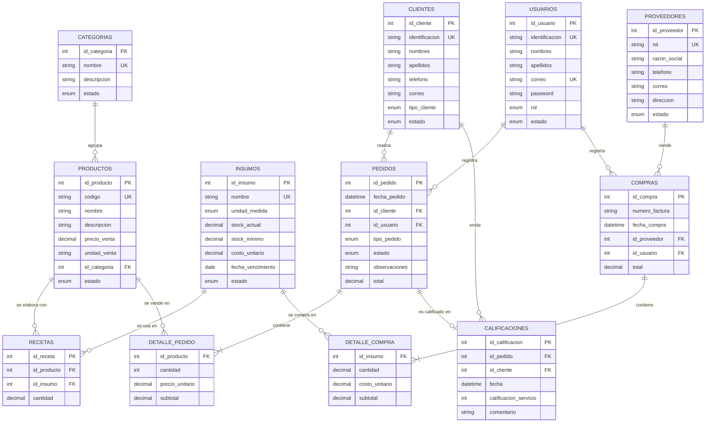

# Manual de Configuración de Base de Datos

**Proyecto:** API REST — Unidad Productiva de Gastronomía (CGDSS)
**Base de datos:** `bd_gastronomia` — MongoDB 7.0 sobre Docker Desktop
**Programa:** Análisis y Desarrollo de Software — Ficha 3312744
**Evidencia:** EA4 — Anexo (Formato 6. Manual de Configuración de Base de Datos)

---

## 1. Historial de revisión y cambios

| Versión | Fecha | Descripción del cambio | Elaboró | Revisó | Aprobó |
|---|---|---|---|---|---|
| 1.0 | 21/10/2026 | Versión inicial: modelo, diccionario, scripts y configuración | *(Nombre del aprendiz)* — Aprendiz ADSO | *(Nombre del instructor)* — Instructor | *(Nombre del líder)* — Líder Unidad Productiva de Gastronomía |
| | | | | | |

## 2. Introducción

La base de datos `bd_gastronomia` centraliza la información de la Unidad Productiva de Gastronomía
del Centro de Gestión y Desarrollo Sostenible Surcolombiano: recetas (fichas técnicas), inventario
de insumos, compras a proveedores, clientes, pedidos, ventas y calificaciones de los clientes.

Es la capa de persistencia de la **API REST** construida con Python/FastAPI. La API es el único
punto de acceso para las aplicaciones (web y móvil, en una fase posterior); se conecta con un
usuario de privilegios mínimos y aplica las reglas de negocio (RN01–RN06) antes de escribir.

En esta variante del proyecto **toda la información se almacena en MongoDB**: las entidades que el
instructivo plantea como tablas relacionales se modelan como colecciones con validación
`$jsonSchema`, índices únicos y referencias por identificador, y las calificaciones (información no
estructurada) se almacenan en la colección `calificaciones` de la misma base de datos.

## 3. Alcance

**Procesos cubiertos**

- Usuarios del sistema y roles (ADMIN, CAJERO, COCINERO).
- Categorías y productos con precio de venta.
- Recetas (ficha técnica) y cálculo del costo de producción y margen.
- Inventario de insumos: existencias, stock mínimo, costo y fecha de vencimiento.
- Proveedores y compras de insumos con su detalle (actualiza el inventario).
- Clientes por tipo (APRENDIZ, INSTRUCTOR, FUNCIONARIO, EXTERNO).
- Pedidos con su detalle y estados (PENDIENTE, EN_PREPARACION, ENTREGADO, ANULADO); descuento de
  inventario al entregar.
- Reportes de ventas por periodo y productos más vendidos.
- Calificaciones de clientes sobre pedidos y productos.

**Fuera del prototipo**

- Facturación electrónica, pagos y medios de pago.
- Manejo de inventario por lotes (solo se guarda el vencimiento del lote actual).
- Conversión automática de unidades de medida (la receta usa la unidad del insumo).
- Replicación (replica set), alta disponibilidad y despliegue en la nube.
- Aplicaciones web y móvil que consumirán la API.

## 4. Responsables e involucrados

| Nombre | Rol en el proyecto | Responsabilidad |
|---|---|---|
| *(Nombre del aprendiz)* | Responsable — Aprendiz ADSO | Diseño, construcción, pruebas y documentación de la base de datos y la API |
| *(Nombre del instructor)* | Revisor — Instructor | Revisión técnica y evaluación de la evidencia |
| *(Nombre del líder)* | Involucrado — Líder de la Unidad Productiva de Gastronomía | Suministro de requerimientos y aprobación funcional |

## 5. Modelo Entidad Relación (MER)

El modelo conceptual mantiene las entidades y cardinalidades propuestas en el instructivo.
`detalle_compra` y `detalle_pedido` existen como entidades débiles que, en el modelo físico
MongoDB, se **embeben** dentro de la compra y del pedido.



> Para la entrega, este diagrama puede abrirse en <https://mermaid.live> o en draw.io
> (*Organizar → Insertar → Avanzado → Mermaid*) y exportarse como imagen.

**Cardinalidades**

| Relación | Cardinalidad | Implementación en MongoDB |
|---|---|---|
| Categoría — Productos | 1:N | `productos.id_categoria` (referencia) |
| Producto — Insumo | N:M | Colección `recetas` (`id_producto`, `id_insumo`) con índice único compuesto |
| Cliente — Pedidos | 1:N | `pedidos.id_cliente` (referencia) |
| Usuario — Pedidos / Compras | 1:N | `pedidos.id_usuario`, `compras.id_usuario` (referencia) |
| Pedido — Productos | N:M | Arreglo embebido `pedidos.detalle[]` |
| Proveedor — Compras | 1:N | `compras.id_proveedor` (referencia) |
| Compra — Insumos | N:M | Arreglo embebido `compras.detalle[]` |
| Pedido — Calificación | 1:0..1 | `calificaciones.id_pedido` con índice único |

## 6. Diccionario de datos

Convenciones: **Tipo** = tipo BSON. `number` = int, long, double o decimal. **Llave**: PK = identificador
de negocio con índice único; UQ = índice único; FK = referencia validada por la API; IX = índice
secundario. Todas las colecciones tienen además el campo interno `_id` (ObjectId) que la API nunca expone.

### 6.1 usuarios

| Campo | Tipo | Nulo | Llave | Defecto / Restricción | Descripción |
|---|---|---|---|---|---|
| id_usuario | int | No | PK (`uq_usuarios_id`) | Secuencia `contadores` | Identificador del usuario |
| identificacion | string(5–20) | No | UQ | | Documento de identidad |
| nombres | string(2–80) | No | | | Nombres |
| apellidos | string(2–80) | No | | | Apellidos |
| correo | string(≤120) | No | UQ | Patrón de correo; se guarda en minúsculas | Usuario de acceso |
| password | string(59–255) | No | | Hash bcrypt (12 rondas) | Contraseña cifrada; nunca se devuelve (RN06) |
| rol | enum | No | | ADMIN, CAJERO, COCINERO | Rol del usuario |
| estado | enum | No | | 'ACTIVO' · ACTIVO, INACTIVO | Estado del usuario |

### 6.2 categorias

| Campo | Tipo | Nulo | Llave | Defecto / Restricción | Descripción |
|---|---|---|---|---|---|
| id_categoria | int | No | PK | Secuencia | Identificador |
| nombre | string(2–60) | No | UQ | | Nombre de la categoría |
| descripcion | string(≤200) | Sí | | | Descripción |
| estado | enum | No | | 'ACTIVO' · ACTIVO, INACTIVO | Estado |

### 6.3 productos

| Campo | Tipo | Nulo | Llave | Defecto / Restricción | Descripción |
|---|---|---|---|---|---|
| id_producto | int | No | PK | Secuencia | Identificador del producto |
| codigo | string(1–20) | No | UQ | | Código interno |
| nombre | string(2–100) | No | | | Nombre del producto |
| descripcion | string | Sí | | | Descripción |
| precio_venta | number | No | | `> 0` (minimum 0, exclusiveMinimum) | Precio de venta |
| unidad_venta | string(≤20) | No | | | Porción, unidad, vaso, paquete… |
| id_categoria | int | No | FK → categorias, IX | Categoría ACTIVA | Categoría del producto |
| estado | enum | No | | 'DISPONIBLE' · DISPONIBLE, AGOTADO, INACTIVO | Estado |

### 6.4 insumos

| Campo | Tipo | Nulo | Llave | Defecto / Restricción | Descripción |
|---|---|---|---|---|---|
| id_insumo | int | No | PK | Secuencia | Identificador |
| nombre | string(2–100) | No | UQ | | Nombre del insumo |
| unidad_medida | enum | No | | g, kg, ml, l, lb, unidad | Unidad de medida |
| stock_actual | number | No | | 0 · `>= 0` | Existencias (3 decimales) |
| stock_minimo | number | No | | 0 · `>= 0` | Nivel mínimo de alerta |
| costo_unitario | number | No | | 0 · `>= 0` | Costo por unidad de medida (último costo de compra) |
| fecha_vencimiento | date | Sí | IX | Medianoche hora Bogotá | Vencimiento del lote actual |
| estado | enum | No | | 'ACTIVO' · ACTIVO, INACTIVO | Estado |

### 6.5 recetas

| Campo | Tipo | Nulo | Llave | Defecto / Restricción | Descripción |
|---|---|---|---|---|---|
| id_receta | int | No | PK | Secuencia | Identificador del ítem |
| id_producto | int | No | FK → productos, UQ compuesto (`id_producto`,`id_insumo`) | | Producto |
| id_insumo | int | No | FK → insumos, IX | | Insumo utilizado |
| cantidad | number | No | | `> 0`, 3 decimales | Cantidad por unidad de producto (en la unidad del insumo) |

### 6.6 proveedores

| Campo | Tipo | Nulo | Llave | Defecto / Restricción | Descripción |
|---|---|---|---|---|---|
| id_proveedor | int | No | PK | Secuencia | Identificador |
| nit | string(5–20) | No | UQ | | NIT o documento |
| razon_social | string(2–120) | No | | | Nombre o razón social |
| telefono | string(≤20) | Sí | | | Teléfono |
| correo | string(≤120) | Sí | | Formato de correo (API) | Correo |
| direccion | string(≤150) | Sí | | | Dirección |
| estado | enum | No | | 'ACTIVO' · ACTIVO, INACTIVO | Estado |

### 6.7 compras (con detalle embebido)

| Campo | Tipo | Nulo | Llave | Defecto / Restricción | Descripción |
|---|---|---|---|---|---|
| id_compra | int | No | PK | Secuencia | Identificador de la compra |
| numero_factura | string(1–30) | No | UQ compuesto (`id_proveedor`,`numero_factura`) | | Factura del proveedor |
| fecha_compra | date | No | | Fecha/hora actual | Fecha de la compra |
| id_proveedor | int | No | FK → proveedores | Proveedor ACTIVO | Proveedor |
| id_usuario | int | No | FK → usuarios | Usuario del token | Usuario que registra |
| total | number | No | | `>= 0` · calculado por la API | Valor total |
| detalle | array | No | IX (`detalle.id_insumo`) | Mínimo 1 ítem | Ítems de la compra |
| detalle[].id_insumo | int | No | FK → insumos | Insumo ACTIVO | Insumo comprado |
| detalle[].nombre_insumo | string | Sí | | Copia al momento de la compra | Nombre del insumo |
| detalle[].cantidad | number | No | | `> 0` | Cantidad comprada |
| detalle[].costo_unitario | number | No | | `>= 0` | Costo unitario |
| detalle[].subtotal | number | No | | cantidad × costo_unitario | Subtotal |
| detalle[].fecha_vencimiento | date | Sí | | | Vencimiento del lote comprado |

### 6.8 clientes

| Campo | Tipo | Nulo | Llave | Defecto / Restricción | Descripción |
|---|---|---|---|---|---|
| id_cliente | int | No | PK | Secuencia | Identificador |
| identificacion | string(5–20) | No | UQ | | Documento |
| nombres | string(2–80) | No | | | Nombres |
| apellidos | string(2–80) | No | | | Apellidos |
| telefono | string(≤20) | Sí | | | Teléfono |
| correo | string(≤120) | Sí | | | Correo |
| tipo_cliente | enum | No | | APRENDIZ, INSTRUCTOR, FUNCIONARIO, EXTERNO | Tipo de cliente |
| estado | enum | No | | 'ACTIVO' · ACTIVO, INACTIVO | Estado (agregado para RN04) |

### 6.9 pedidos (con detalle embebido)

| Campo | Tipo | Nulo | Llave | Defecto / Restricción | Descripción |
|---|---|---|---|---|---|
| id_pedido | int | No | PK | Secuencia | Identificador |
| fecha_pedido | date | No | IX (`estado`,`fecha_pedido`) | Fecha/hora actual | Fecha y hora del pedido |
| id_cliente | int | No | FK → clientes, IX | Cliente ACTIVO | Cliente |
| id_usuario | int | No | FK → usuarios | Usuario del token | Usuario que registra |
| tipo_pedido | enum | No | | MESA, PARA_LLEVAR, EVENTO | Tipo de pedido |
| estado | enum | No | IX | 'PENDIENTE' · PENDIENTE, EN_PREPARACION, ENTREGADO, ANULADO | Estado |
| observaciones | string(≤300) | Sí | | | Observaciones |
| total | number | No | | Σ subtotales (RN01) | Total calculado |
| fecha_entrega | date | Sí | | Se asigna al pasar a ENTREGADO | Fecha de entrega |
| detalle | array | No | IX (`detalle.id_producto`) | Mínimo 1 ítem | Ítems del pedido |
| detalle[].id_producto | int | No | FK → productos | Producto DISPONIBLE | Producto |
| detalle[].nombre_producto | string | Sí | | Copia al momento del pedido | Nombre del producto |
| detalle[].cantidad | int | No | | `>= 1` | Cantidad |
| detalle[].precio_unitario | number | No | | `> 0` · precio_venta del producto | Precio unitario |
| detalle[].subtotal | number | No | | cantidad × precio_unitario (RN01) | Subtotal |

### 6.10 calificaciones

| Campo | Tipo | Nulo | Llave | Defecto / Restricción | Descripción |
|---|---|---|---|---|---|
| id_calificacion | int | No | PK | Secuencia | Identificador |
| id_pedido | int | No | UQ, FK → pedidos | Pedido ENTREGADO | Pedido calificado (una calificación por pedido) |
| id_cliente | int | No | FK → clientes | Tomado del pedido | Cliente que califica |
| fecha | date | No | | Fecha/hora actual | Fecha de la calificación |
| calificacion_servicio | int | No | | 1 a 5 | Calificación del servicio |
| comentario | string(≤500) | Sí | | | Opinión libre |
| productos | array | No | IX (`productos.id_producto`) | Productos del pedido | Calificación por producto |
| productos[].id_producto | int | No | FK → productos | | Producto |
| productos[].nombre | string | Sí | | Tomado del pedido | Nombre del producto |
| productos[].calificacion | int | No | | 1 a 5 | Calificación del producto |

Ejemplo de documento:

```json
{
  "id_calificacion": 1,
  "id_pedido": 1,
  "id_cliente": 1,
  "fecha": "2026-10-01T14:10:00-05:00",
  "calificacion_servicio": 5,
  "comentario": "Excelente atención y buen sabor",
  "productos": [
    { "id_producto": 1, "nombre": "Almuerzo ejecutivo", "calificacion": 5 },
    { "id_producto": 4, "nombre": "Jugo de lulo", "calificacion": 4 }
  ]
}
```

### 6.11 contadores (colección técnica)

| Campo | Tipo | Nulo | Llave | Defecto / Restricción | Descripción |
|---|---|---|---|---|---|
| _id | string | No | PK | Nombre de la colección | Secuencia a la que pertenece |
| seq | int | No | | Se incrementa con `$inc` atómico | Último id asignado (equivale a AUTO_INCREMENT) |

## 7. Modelo físico (documentos)

MongoDB no tiene "ingeniería inversa" como MySQL Workbench; el modelo físico se documenta con la
estructura de los documentos y se puede verificar en **MongoDB Compass → pestaña *Schema*** y
**pestaña *Validation*** de cada colección.

Decisiones de diseño:

| Decisión | Justificación |
|---|---|
| **Embeber** `detalle` en `pedidos` y `compras` | El detalle no existe sin su encabezado, siempre se lee junto y no se modifica después de entregado/registrado. Se guarda en una sola escritura atómica. |
| **Referenciar** productos, clientes, proveedores, insumos y usuarios por id entero | Son entidades con ciclo de vida propio y se consultan de forma independiente. |
| **Colección `recetas` separada** (N:M) | Permite CRUD por ítem, índice único (producto, insumo) y consultas inversas (en qué productos se usa un insumo). |
| **Copia de `nombre_producto` / `nombre_insumo`** en el detalle | Conserva el dato histórico aunque el producto cambie de nombre (patrón *extended reference*). |
| **ids enteros con `contadores`** | Mantiene identificadores legibles como en el modelo relacional (`/productos/4`). |
| **Fechas en UTC** | MongoDB guarda `Date` en UTC; la API convierte a America/Bogota al responder y en los reportes (`$dateToString` con `timezone`). |

Diagrama físico simplificado:

```
pedidos                                   compras
{ id_pedido, fecha_pedido,                { id_compra, numero_factura, fecha_compra,
  id_cliente ──► clientes,                  id_proveedor ──► proveedores,
  id_usuario ──► usuarios,                  id_usuario ──► usuarios,
  tipo_pedido, estado, total,               total,
  detalle: [                                detalle: [
    { id_producto ──► productos,              { id_insumo ──► insumos,
      nombre_producto, cantidad,                nombre_insumo, cantidad,
      precio_unitario, subtotal } ] }           costo_unitario, subtotal } ] }

productos { id_producto, codigo, ..., id_categoria ──► categorias }
recetas   { id_receta, id_producto ──► productos, id_insumo ──► insumos, cantidad }
calificaciones { id_calificacion, id_pedido ──► pedidos, id_cliente ──► clientes,
                 productos: [ { id_producto ──► productos, nombre, calificacion } ] }
```

Índices creados (ver `c_01_ddl_colecciones.js`):

| Colección | Índice | Tipo |
|---|---|---|
| usuarios | id_usuario · identificacion · correo | Únicos |
| categorias | id_categoria · nombre | Únicos |
| productos | id_producto · codigo (únicos) · id_categoria | Único / secundario |
| insumos | id_insumo · nombre (únicos) · fecha_vencimiento | Único / secundario |
| recetas | id_receta · (id_producto, id_insumo) (únicos) · id_insumo | Único / compuesto / secundario |
| proveedores | id_proveedor · nit | Únicos |
| compras | id_compra · (id_proveedor, numero_factura) (únicos) · detalle.id_insumo | Único / multikey |
| clientes | id_cliente · identificacion | Únicos |
| pedidos | id_pedido (único) · (id_cliente, fecha_pedido) · (estado, fecha_pedido) · detalle.id_producto | Único / compuesto / multikey |
| calificaciones | id_calificacion · id_pedido (únicos) · productos.id_producto | Único / multikey |

## 8. Justificación del motor seleccionado

### 8.1 Comparativa

| Criterio | MongoDB 7 | MySQL 8 | PostgreSQL 16 | SQL Server 2022 | Oracle 23ai |
|---|---|---|---|---|---|
| Modelo | Documentos (BSON) | Relacional | Relacional + JSONB | Relacional | Relacional + JSON |
| Licencia | SSPL / Community gratuita | GPL / Community gratuita | Libre (PostgreSQL) | Comercial (Express gratuita con límites) | Comercial (Free con límites) |
| Esquema | Flexible con validación `$jsonSchema` | Rígido (DDL) | Rígido + JSONB | Rígido | Rígido |
| Imagen Docker oficial | Sí, ligera | Sí | Sí | Sí (pesada) | Sí (pesada) |
| Transacciones ACID | Por documento; multi-documento con replica set | Sí | Sí | Sí | Sí |
| Datos anidados (detalle, calificaciones) | Nativo (arreglos embebidos) | Tablas adicionales + JOIN | JSONB o tablas | Tablas o JSON | Tablas o JSON |
| Agregaciones / reportes | Aggregation Pipeline | SQL | SQL avanzado | SQL / T-SQL | SQL / PL-SQL |
| Integración con Python | `pymongo` | `pymysql`, SQLAlchemy | `psycopg`, SQLAlchemy | `pyodbc` | `oracledb` |
| Curva de aprendizaje en el programa | Media | Baja | Media | Media | Alta |

### 8.2 Justificación

Se seleccionó **MongoDB** como motor único porque:

1. **Encaja con el dominio:** pedidos y compras son documentos "encabezado + detalle" que se crean y
   leen completos; embeber el detalle evita JOINs y garantiza escritura atómica de cada pedido.
2. **Información no estructurada:** las calificaciones (comentarios libres y lista variable de
   productos calificados) se modelan naturalmente como documentos, como lo pide el RF12.
3. **Integridad suficiente para el prototipo:** `$jsonSchema` (tipos, enums, rangos, campos
   obligatorios), índices únicos (equivalentes a UNIQUE/PK) y validación de referencias en la capa de
   servicios de la API (equivalente a FK).
4. **Operación simple:** un solo contenedor (`mongo:7.0`) en Docker Desktop, sin instalar nada en el
   equipo; un único driver (`pymongo`) en la API.
5. **Escalabilidad futura:** la misma API podrá conectarse a un replica set o a MongoDB Atlas cuando la
   unidad productiva pase a producción.

Limitación asumida: con un servidor MongoDB independiente (sin replica set) no hay transacciones
multi-documento. Por eso RN03 se implementa con verificación previa + actualizaciones condicionales
atómicas por insumo (`stock_actual >= requerido`) y compensación (reintegro) si alguna falla.

## 9. Requisitos de configuración

| Componente | Versión | Observación |
|---|---|---|
| Windows 10/11 o Linux/macOS | — | Con virtualización habilitada |
| Docker Desktop | 4.x (Engine 24+, Compose v2) | Probado con Engine 29.9 |
| Imagen `mongo` | 7.0 | Incluye `mongosh`, `mongodump`, `mongorestore` |
| Imagen `python` | 3.12-slim | Contenedor de la API |
| MongoDB Compass / Studio 3T | Última | Cliente gráfico |
| Postman o Thunder Client | Última | Pruebas |
| Visual Studio Code, Git | Última | Desarrollo y versionamiento |

Librerías de Python (`requirements.txt`): fastapi 0.115, uvicorn 0.34, pymongo 4.12,
pydantic 2.11 (+ email-validator), PyJWT 2.10, bcrypt 4.3, python-dotenv 1.1, tzdata.

Variables de entorno (`.env`, basado en `.env.example`):

| Variable | Uso |
|---|---|
| MONGO_ROOT_USER / MONGO_ROOT_PASSWORD | Administrador del contenedor (solo inicialización y respaldos) |
| MONGO_DB | Nombre de la base (`bd_gastronomia`) |
| MONGO_APP_USER / MONGO_APP_PASSWORD | Usuario de la API (privilegios mínimos) |
| MONGO_REPORT_USER / MONGO_REPORT_PASSWORD | Usuario de solo lectura |
| JWT_SECRET / JWT_ALGORITHM / JWT_EXPIRE_MINUTES | Firma y expiración del token |
| ZONA_HORARIA | America/Bogota |

## 10. Scripts

Ubicados en la carpeta `database/` del repositorio. Se ejecutan automáticamente, en orden, la primera
vez que se crea el volumen del contenedor (montados en `/docker-entrypoint-initdb.d`).

| Script | Equivale a | Contenido |
|---|---|---|
| `c_01_ddl_colecciones.js` | DDL | Crea las 10 colecciones con validador `$jsonSchema` (`validationLevel: strict`, `validationAction: error`), índices únicos, compuestos y multikey, y la colección `contadores`. |
| `c_02_dml_datos_prueba.js` | DML | Datos de prueba: 10 usuarios, 10 categorías, 13 productos, 15 insumos, 47 ítems de receta, 10 proveedores, 10 compras, 12 clientes y 14 pedidos (totales calculados según RN01) e inicializa los contadores. |
| `c_03_dcl_usuarios.js` | DCL | Crea el rol `c_rol_api_gastronomia` (find, insert, update, remove sobre `bd_gastronomia`), el usuario de la API con ese rol y un usuario de reportes con rol `read`. |
| `c_04_mongo_calificaciones.js` | DML NoSQL | 10 calificaciones construidas a partir de pedidos ENTREGADOS. |

Fragmento DDL (validación de `productos`):

```javascript
db.createCollection("productos", {
  validator: { $jsonSchema: {
    bsonType: "object",
    required: ["id_producto", "codigo", "nombre", "precio_venta", "unidad_venta", "id_categoria", "estado"],
    properties: {
      id_producto: { bsonType: ["int", "long"] },
      codigo: { bsonType: "string", minLength: 1, maxLength: 20 },
      precio_venta: { bsonType: ["int", "long", "double", "decimal"], minimum: 0, exclusiveMinimum: true },
      estado: { enum: ["DISPONIBLE", "AGOTADO", "INACTIVO"] }
    }
  }},
  validationLevel: "strict", validationAction: "error"
});
db.productos.createIndex({ codigo: 1 }, { unique: true, name: "uq_productos_codigo" });
```

Fragmento DCL:

```javascript
db.createRole({
  role: "c_rol_api_gastronomia",
  privileges: [{ resource: { db: "bd_gastronomia", collection: "" },
                 actions: ["find", "insert", "update", "remove"] }],
  roles: []
});
db.createUser({ user: process.env.C_MONGO_APP_USER, pwd: process.env.C_MONGO_APP_PASSWORD,
                roles: [{ role: "c_rol_api_gastronomia", db: "bd_gastronomia" }] });
```

## 11. Configuración y ejecución de la base de datos

> En cada paso tome una captura de pantalla donde se vea la **fecha y hora del sistema**.

**Paso 1. Clonar el repositorio y crear el `.env`**

```powershell
git clone <url-del-repositorio>
cd api_gastronomia
copy .env.example .env    # editar las claves
```

**Paso 2. Levantar los contenedores**

```powershell
docker compose up -d --build
docker compose ps
```

Resultado esperado: `c_mongo_gastronomia` en estado *healthy* y `c_api_gastronomia` en *running*.

*[Captura 1: salida de `docker compose ps` y Docker Desktop con los contenedores]*

**Paso 3. Verificar la ejecución de los scripts**

```powershell
docker logs c_mongo_gastronomia 2>&1 | findstr "ejecutado"
```

Debe mostrar las cuatro líneas `c_0X_... ejecutado correctamente`.

*[Captura 2: logs de inicialización]*

**Paso 4. Conectarse con mongosh (equivalente a SHOW TABLES / DESCRIBE)**

```powershell
docker exec -it c_mongo_gastronomia mongosh -u <MONGO_ROOT_USER> -p --authenticationDatabase admin bd_gastronomia
```

```javascript
new Date()                                   // fecha y hora para la evidencia
show collections                             // ≈ SHOW TABLES
db.getCollectionInfos({ name: "productos" })[0].options.validator   // ≈ DESCRIBE
db.productos.getIndexes()
db.productos.countDocuments()
db.getUsers()                                // usuarios y roles (DCL)
```

*[Captura 3: `show collections`] · [Captura 4: validador e índices de `productos`]*

**Paso 5. Consultas de verificación**

```javascript
// Insumos con stock bajo (≈ WHERE stock_actual <= stock_minimo)
db.insumos.find({ $expr: { $lte: ["$stock_actual", "$stock_minimo"] } }, { _id: 0, nombre: 1, stock_actual: 1, stock_minimo: 1 })

// Receta con nombre del insumo (≈ JOIN)
db.recetas.aggregate([
  { $match: { id_producto: 1 } },
  { $lookup: { from: "insumos", localField: "id_insumo", foreignField: "id_insumo", as: "insumo" } },
  { $unwind: "$insumo" },
  { $project: { _id: 0, insumo: "$insumo.nombre", cantidad: 1, costo: { $multiply: ["$cantidad", "$insumo.costo_unitario"] } } }
])

// Ventas de octubre (≈ SUM / COUNT / GROUP BY)
db.pedidos.aggregate([
  { $match: { estado: "ENTREGADO", fecha_pedido: { $gte: ISODate("2026-10-01T05:00:00Z"), $lt: ISODate("2026-11-01T05:00:00Z") } } },
  { $group: { _id: null, pedidos: { $sum: 1 }, total: { $sum: "$total" } } }
])

// Promedio de calificación por producto
db.calificaciones.aggregate([
  { $unwind: "$productos" },
  { $group: { _id: "$productos.nombre", promedio: { $avg: "$productos.calificacion" }, votos: { $sum: 1 } } },
  { $sort: { promedio: -1 } }
])
```

*[Captura 5: resultados de las consultas]*

**Paso 6. Probar la validación y los privilegios mínimos**

```powershell
docker exec -it c_mongo_gastronomia mongosh -u <MONGO_APP_USER> -p --authenticationDatabase bd_gastronomia bd_gastronomia
```

```javascript
db.productos.insertOne({ id_producto: 999, codigo: "Z", nombre: "Z", precio_venta: -5,
                         unidad_venta: "u", id_categoria: 1, estado: "DISPONIBLE" })
// → MongoServerError: Document failed validation
db.productos.drop()
// → MongoServerError: not authorized ... (Unauthorized)
```

*[Captura 6: errores de validación y de autorización]*

**Paso 7. Conectarse con MongoDB Compass**

Cadena de conexión (usuario de solo lectura):
`mongodb://<MONGO_REPORT_USER>:<clave>@localhost:27017/bd_gastronomia?authSource=bd_gastronomia`

*[Captura 7: Compass mostrando las colecciones, pestañas Schema y Validation]*

**Paso 8. Verificar la API**

Abrir <http://localhost:8000/docs>, ejecutar `POST /api/v1/auth/login` y luego un endpoint protegido.

*[Captura 8: Swagger con respuesta 200]*

## 12. Otras consideraciones

**Codificación de caracteres.** MongoDB almacena todo el texto en **UTF-8** de forma nativa (no
requiere configurar charset como `utf8mb4` en MySQL); tildes y "ñ" se guardan sin conversión.

**Zona horaria.** Los contenedores usan `TZ=America/Bogota`. MongoDB guarda las fechas en UTC; la API
(`pymongo` con `tz_aware=True, tzinfo=America/Bogota`) las devuelve con desfase `-05:00` y los
reportes agrupan por día con `timezone: "America/Bogota"`.

**Respaldo y restauración** (los archivos quedan en `./respaldos`, montado en el contenedor):

```powershell
# Respaldo
docker exec c_mongo_gastronomia sh -c 'mongodump -u "$MONGO_INITDB_ROOT_USERNAME" -p "$MONGO_INITDB_ROOT_PASSWORD" --authenticationDatabase admin --db bd_gastronomia --gzip --archive=/respaldos/bd_gastronomia.gz'

# Restauración (reemplaza las colecciones existentes)
docker exec c_mongo_gastronomia sh -c 'mongorestore -u "$MONGO_INITDB_ROOT_USERNAME" -p "$MONGO_INITDB_ROOT_PASSWORD" --authenticationDatabase admin --gzip --archive=/respaldos/bd_gastronomia.gz --drop'
```

Se recomienda un respaldo diario programado y conservar al menos 7 copias fuera del equipo.

**Manejo seguro de credenciales.**

- Las claves viven solo en `.env`, que está en `.gitignore`; el repositorio incluye únicamente
  `.env.example` sin valores reales.
- La API usa el usuario `c_api_gastronomia` (find/insert/update/remove); no puede borrar colecciones,
  crear índices ni administrar usuarios. El usuario root solo se usa para inicializar y respaldar.
- Las contraseñas de los usuarios del sistema se guardan con bcrypt y nunca se devuelven (RN06).
- El puerto 27017 se publica solo para desarrollo; en producción debe eliminarse del
  `docker-compose.yml` para que MongoDB solo sea accesible desde la red interna de Docker.
- La clave `JWT_SECRET` debe ser larga y aleatoria y cambiarse si se expone.
